# Arena Forge Pro v3.60.286 — Boss Yürüyüş, Zemin ve Yön Onarımı · Test Raporu

Otomatik test: `test/boss_gait_test.js` · 14 boss × 2 takım (KIRMIZI/MAVİ) × 3 çözünürlük (740×360, 667×375, 800×360) = **84 koşu**: **84 GEÇTİ**, 0 KALDI, 0 TEST EDİLEMEDİ.

Ölçümler oyunun kendi `draw()` fonksiyonuyla, başsız Chromium (WebGL: SwiftShader) üzerinde kare kare alınmıştır. **Gerçek Android WebView üzerinde test YAPILAMADI** (bu ortamda cihaz/emülatör yok).

## Test edilen hareketler ve ölçütler

1. **Doğma ve zemine yerleşme** — 30 kare bekleme.
2. **Yürüme** (KIRMIZI sola, MAVİ sağa) — 100 kare.
3. **Durma** — 70 kare; bekleme animasyonuna dönüş ve yer değiştirmeme.
4. **Hedefe dönme ve saldırma** — arkaya bir hedef konur; boss ona döner, 3 gerçek saldırı olayı (`af321MarkHit`), sonra hedef kalkınca takım yönüne döner.
5. **Hasar alma** — `hitFlash` + can düşüşü.
6. **Ölme ve sahneden kaybolma** — ölüm kaydı bossun KENDİ iskeleti/atlası olmalı, sonunda sahneden silinmeli.

| Ölçüt | Eşik |
|---|---|
| Zemin teması (en alt opak nokta, GPU deri ağıyla birebir CPU hesabı) | zeminin altına, görselin kendi ön-uzantı payından (ör. öne uzanan kılıç) fazla inmez; ≤ 3 px |
| Ayak tabanı teması | her karede en az bir ayak/pati tabanı zemine ≤ 1.5 px |
| Basan ayağın kayması | basma fazında ekran x değişimi < 1 px/kare |
| Ayakların sırayla hareketi | bipedde iki ayak ayrı fazlarda > 1.5 px kalkar; dört ayaklıda ≥ 3 uzuv; hiçbir karede tüm uzuvlar havada değil |
| Yön | yürürken takım yönü; hedef arkadaysa hedefe; çizilen ayna = bakış × doğal bakış |

## Özet (tüm çözünürlükler)

| Boss (kimlik) | Mod | Zemin | Ayak teması | Yürüyüş | Yön (sağ/sol + hedef) | Durma | Saldırı | Hasar | Ölüm | Sonuç |
|---|---|---|---|---|---|---|---|---|---|---|
| Kadim Dev (taş boss) (`boss.ancient_giant`) | Hikâye Seferi · Doruk Kulesi (5. kat) · Gökyüzü · Lonca/Örümcek Akını (warden) | 6/6 | 6/6 | 6/6 | 6/6 | 6/6 | 6/6 | 6/6 | 6/6 | **GEÇTİ** |
| Ölüm Lordu (`boss.death_lord`) | Hikâye Seferi · Kule · Gökyüzü · Lonca (executioner) | 6/6 | 6/6 | 6/6 | 6/6 | 6/6 | 6/6 | 6/6 | 6/6 | **GEÇTİ** |
| Orman Koruyucusu (`boss.forest_guardian`) | Hikâye Seferi · Kule · Gökyüzü · Lonca (mender) | 6/6 | 6/6 | 6/6 | 6/6 | 6/6 | 6/6 | 6/6 | 6/6 | **GEÇTİ** |
| Cehennem Behemotu (`boss.infernal_behemoth`) | Hikâye Seferi · Kule · Gökyüzü · Lonca (berserker) | 6/6 | 6/6 | 6/6 | 6/6 | 6/6 | 6/6 | 6/6 | 6/6 | **GEÇTİ** |
| Gölge Avcısı (`boss.shadow_stalker`) | Hikâye Seferi · Kule · Gökyüzü · Lonca (stalker) | 6/6 | 6/6 | 6/6 | 6/6 | 6/6 | 6/6 | 6/6 | 6/6 | **GEÇTİ** |
| Lav Ejderhası (`boss.lava_dragon`) | Hikâye Seferi · Kule · Gökyüzü · Lonca (siege) | 6/6 | 6/6 | 6/6 | 6/6 | 6/6 | 6/6 | 6/6 | 6/6 | **GEÇTİ** |
| Fırtına Ejderi (`boss.storm_dragon`) | Hikâye Seferi · Kule · Gökyüzü · Lonca (storm) | 6/6 | 6/6 | 6/6 | 6/6 | 6/6 | 6/6 | 6/6 | 6/6 | **GEÇTİ** |
| Zehir Hidrası (`boss.venom_hydra`) | Hikâye Seferi · Kule · Gökyüzü · Lonca (venom) | 6/6 | 6/6 | 6/6 | 6/6 | 6/6 | 6/6 | 6/6 | 6/6 | **GEÇTİ** |
| Örümcek Kraliçe (`boss.spider_queen`) | Örümcek Akını | 6/6 | 6/6 | 6/6 | 6/6 | 6/6 | 6/6 | 6/6 | 6/6 | **GEÇTİ** |
| Küllerin Hükümdarı (`afp263:boss_kullerin_hukumdari`) | Karanlık Geçit | 6/6 | 6/6 | 6/6 | 6/6 | 6/6 | 6/6 | 6/6 | 6/6 | **GEÇTİ** |
| Uçurum Ejderi (`afp263:boss_ucurum_ejderi`) | Karanlık Geçit | 6/6 | 6/6 | 6/6 | 6/6 | 6/6 | 6/6 | 6/6 | 6/6 | **GEÇTİ** |
| Boşluk İmparatoru (`afp263:boss_bosluk_imparatoru`) | Karanlık Geçit | 6/6 | – (bacak yok) | 6/6 süzülme (adım yok) | 6/6 | 6/6 | 6/6 | 6/6 | 6/6 | **GEÇTİ** |
| Taş Kolosus (taş boss) (`colossus.stone_golem`) | Kristal Kolos | 6/6 | 6/6 | 6/6 | 6/6 | 6/6 | 6/6 | 6/6 | 6/6 | **GEÇTİ** |
| Ayna Celladı (Yankı İstilası final bossu) (`echo.mirror_executioner`) | Yankı İstilası | 6/6 | 6/6 | 6/6 | 6/6 | 6/6 | 6/6 | 6/6 | 6/6 | **GEÇTİ** |

## Boss başına ayrıntı

### Kadim Dev (taş boss) — `boss.ancient_giant`

- **Mod(lar):** Hikâye Seferi · Doruk Kulesi (5. kat) · Gökyüzü · Lonca/Örümcek Akını (warden)
- **Bulunan hata:** Havada duruyordu (alttaki %10 şeffaf boşluk ayak sayılıyordu + sinüs zıplaması), tek sabit resim olarak zeminde kayıyordu, sağa bakarken sola yürüyordu; ölünce yerine golem iskeleti düşüyordu.
- **Kök neden:** af36DrawBossArtwork resmi `drawImage(img,-w/2,-h)` ile çiziyordu: pivot resmin alt kenarıydı, ayak değil (335 px resimde 34 px boşluk). Yön hiç çevrilmiyordu; yürüme/saldırı/ölüm animasyonu yoktu; ölüm, af320Resolve'un boss için döndürdüğü "golem" türüyle çiziliyordu.
- **Yapılan düzeltme:** Boss, mevcut AF321 iskelet motoruna bağlandı: kendi görselinden kurulan deri-ağ, iki kemikli IK bacaklar, adım fazı GERÇEK yer değiştirmeyle ilerler (basan ayak kaymaz). Ayak pivotu alfa ölçümünden değil uzuv tabanından (ayak/pati altı) hesaplanır; yürürken her ayak kendi taban derinliğiyle zemine basar. Kanatsız bipedlerde düz taban kemiği, diz altı silah/pençe pikselleri bacağa yapışmaz, kılıç/yumruk zemine girmez (kemik sınırı), son adımda basan taban zemine oturur. Yön: hedef varsa hedefe, yoksa takım yönüne; yalnız karakter çizimi çevrilir. Ölüm: kendi iskeletiyle (golem yok).
- **Zemin temas testi:** 6/6 geçti · en kötü sapma 0.11 px · ayak tabanı boşluğu en çok 0.01 px
- **Yürüyüş testi:** 6/6 geçti · basan ayak kayması en çok 0 px · uzuv başına kalkış kareleri [18, 19]
- **Sağ/sol yön testi:** 6/6 geçti (KIRMIZI→sol, MAVİ→sağ; arkadaki hedefe dönüş; hedef kalkınca takım yönüne dönüş)
- **Animasyon geçiş testi:** durma→bekleme 6/6, saldırı 6/6, hasar 6/6, ölüm ve sahneden kaybolma 6/6
- **Sonuç:** **GEÇTİ**

### Ölüm Lordu — `boss.death_lord`

- **Mod(lar):** Hikâye Seferi · Kule · Gökyüzü · Lonca (executioner)
- **Bulunan hata:** Sabit resim kayıyordu, sağa bakıyordu (kırmızı takım sola gider), kılıç ucu alfa tabanı sayıldığından ayaklar 3 px havadaydı; ölümde golem düşüyordu.
- **Kök neden:** Aynı sabit-resim yolu; ayrıca görselin en alt pikseli öne uzanan kılıç ucu olduğundan "alfa tabanı = ayak" varsayımı yanlıştı.
- **Yapılan düzeltme:** Boss, mevcut AF321 iskelet motoruna bağlandı: kendi görselinden kurulan deri-ağ, iki kemikli IK bacaklar, adım fazı GERÇEK yer değiştirmeyle ilerler (basan ayak kaymaz). Ayak pivotu alfa ölçümünden değil uzuv tabanından (ayak/pati altı) hesaplanır; yürürken her ayak kendi taban derinliğiyle zemine basar. Kanatsız bipedlerde düz taban kemiği, diz altı silah/pençe pikselleri bacağa yapışmaz, kılıç/yumruk zemine girmez (kemik sınırı), son adımda basan taban zemine oturur. Yön: hedef varsa hedefe, yoksa takım yönüne; yalnız karakter çizimi çevrilir. Ölüm: kendi iskeletiyle (golem yok).
- **Zemin temas testi:** 6/6 geçti · en kötü sapma 0.51 px · ayak tabanı boşluğu en çok 0.01 px
- **Yürüyüş testi:** 6/6 geçti · basan ayak kayması en çok 0 px · uzuv başına kalkış kareleri [25, 14]
- **Sağ/sol yön testi:** 6/6 geçti (KIRMIZI→sol, MAVİ→sağ; arkadaki hedefe dönüş; hedef kalkınca takım yönüne dönüş)
- **Animasyon geçiş testi:** durma→bekleme 6/6, saldırı 6/6, hasar 6/6, ölüm ve sahneden kaybolma 6/6
- **Sonuç:** **GEÇTİ**

### Orman Koruyucusu — `boss.forest_guardian`

- **Mod(lar):** Hikâye Seferi · Kule · Gökyüzü · Lonca (mender)
- **Bulunan hata:** Sabit resim kayıyordu, sağa bakıyordu, sinüs zıplaması ayakları zeminden koparıyordu; ölümde golem düşüyordu.
- **Kök neden:** Sabit-resim yolu; düz çizilmiş bacaklar iskelette IK erişimini aşıyordu (basan ayak havada kalıyordu).
- **Yapılan düzeltme:** Boss, mevcut AF321 iskelet motoruna bağlandı: kendi görselinden kurulan deri-ağ, iki kemikli IK bacaklar, adım fazı GERÇEK yer değiştirmeyle ilerler (basan ayak kaymaz). Ayak pivotu alfa ölçümünden değil uzuv tabanından (ayak/pati altı) hesaplanır; yürürken her ayak kendi taban derinliğiyle zemine basar. Kanatsız bipedlerde düz taban kemiği, diz altı silah/pençe pikselleri bacağa yapışmaz, kılıç/yumruk zemine girmez (kemik sınırı), son adımda basan taban zemine oturur. Yön: hedef varsa hedefe, yoksa takım yönüne; yalnız karakter çizimi çevrilir. Ölüm: kendi iskeletiyle (golem yok).
- **Zemin temas testi:** 6/6 geçti · en kötü sapma 0.13 px · ayak tabanı boşluğu en çok 0.01 px
- **Yürüyüş testi:** 6/6 geçti · basan ayak kayması en çok 0.01 px · uzuv başına kalkış kareleri [26, 13]
- **Sağ/sol yön testi:** 6/6 geçti (KIRMIZI→sol, MAVİ→sağ; arkadaki hedefe dönüş; hedef kalkınca takım yönüne dönüş)
- **Animasyon geçiş testi:** durma→bekleme 6/6, saldırı 6/6, hasar 6/6, ölüm ve sahneden kaybolma 6/6
- **Sonuç:** **GEÇTİ**

### Cehennem Behemotu — `boss.infernal_behemoth`

- **Mod(lar):** Hikâye Seferi · Kule · Gökyüzü · Lonca (berserker)
- **Bulunan hata:** Sabit resim kayıyordu, sağa bakıyordu; ölümde golem düşüyordu.
- **Kök neden:** Sabit-resim yolu; diz altındaki pençe pikselleri motorun "diz altı = bacak" kuralıyla bacağa yapışıyordu (adımda zemine giriyordu).
- **Yapılan düzeltme:** Boss, mevcut AF321 iskelet motoruna bağlandı: kendi görselinden kurulan deri-ağ, iki kemikli IK bacaklar, adım fazı GERÇEK yer değiştirmeyle ilerler (basan ayak kaymaz). Ayak pivotu alfa ölçümünden değil uzuv tabanından (ayak/pati altı) hesaplanır; yürürken her ayak kendi taban derinliğiyle zemine basar. Kanatsız bipedlerde düz taban kemiği, diz altı silah/pençe pikselleri bacağa yapışmaz, kılıç/yumruk zemine girmez (kemik sınırı), son adımda basan taban zemine oturur. Yön: hedef varsa hedefe, yoksa takım yönüne; yalnız karakter çizimi çevrilir. Ölüm: kendi iskeletiyle (golem yok).
- **Zemin temas testi:** 6/6 geçti · en kötü sapma 0.82 px · ayak tabanı boşluğu en çok 0.01 px
- **Yürüyüş testi:** 6/6 geçti · basan ayak kayması en çok 0 px · uzuv başına kalkış kareleri [27, 14]
- **Sağ/sol yön testi:** 6/6 geçti (KIRMIZI→sol, MAVİ→sağ; arkadaki hedefe dönüş; hedef kalkınca takım yönüne dönüş)
- **Animasyon geçiş testi:** durma→bekleme 6/6, saldırı 6/6, hasar 6/6, ölüm ve sahneden kaybolma 6/6
- **Sonuç:** **GEÇTİ**

### Gölge Avcısı — `boss.shadow_stalker`

- **Mod(lar):** Hikâye Seferi · Kule · Gökyüzü · Lonca (stalker)
- **Bulunan hata:** Sabit resim kayıyordu, sağa bakıyordu; ölümde golem düşüyordu.
- **Kök neden:** Sabit-resim yolu; tırpan ucu "diz altı" kuralıyla baldıra yapışıyor, adımda 14 px zemine giriyordu.
- **Yapılan düzeltme:** Boss, mevcut AF321 iskelet motoruna bağlandı: kendi görselinden kurulan deri-ağ, iki kemikli IK bacaklar, adım fazı GERÇEK yer değiştirmeyle ilerler (basan ayak kaymaz). Ayak pivotu alfa ölçümünden değil uzuv tabanından (ayak/pati altı) hesaplanır; yürürken her ayak kendi taban derinliğiyle zemine basar. Kanatsız bipedlerde düz taban kemiği, diz altı silah/pençe pikselleri bacağa yapışmaz, kılıç/yumruk zemine girmez (kemik sınırı), son adımda basan taban zemine oturur. Yön: hedef varsa hedefe, yoksa takım yönüne; yalnız karakter çizimi çevrilir. Ölüm: kendi iskeletiyle (golem yok).
- **Zemin temas testi:** 6/6 geçti · en kötü sapma 0.2 px · ayak tabanı boşluğu en çok 0.01 px
- **Yürüyüş testi:** 6/6 geçti · basan ayak kayması en çok 0 px · uzuv başına kalkış kareleri [31, 16]
- **Sağ/sol yön testi:** 6/6 geçti (KIRMIZI→sol, MAVİ→sağ; arkadaki hedefe dönüş; hedef kalkınca takım yönüne dönüş)
- **Animasyon geçiş testi:** durma→bekleme 6/6, saldırı 6/6, hasar 6/6, ölüm ve sahneden kaybolma 6/6
- **Sonuç:** **GEÇTİ**

### Lav Ejderhası — `boss.lava_dragon`

- **Mod(lar):** Hikâye Seferi · Kule · Gökyüzü · Lonca (siege)
- **Bulunan hata:** %5.5 şeffaf alt boşluk nedeniyle havada duruyordu, kayıyordu, sağa bakıyordu; ölümde golem düşüyordu.
- **Kök neden:** Sabit-resim yolu; dört ayaklı için iskelette ön bacak yoktu.
- **Yapılan düzeltme:** Boss, mevcut AF321 iskelet motoruna bağlandı: kendi görselinden kurulan deri-ağ, iki kemikli IK bacaklar, adım fazı GERÇEK yer değiştirmeyle ilerler (basan ayak kaymaz). Ayak pivotu alfa ölçümünden değil uzuv tabanından (ayak/pati altı) hesaplanır; yürürken her ayak kendi taban derinliğiyle zemine basar. Kanatsız bipedlerde düz taban kemiği, diz altı silah/pençe pikselleri bacağa yapışmaz, kılıç/yumruk zemine girmez (kemik sınırı), son adımda basan taban zemine oturur. Yön: hedef varsa hedefe, yoksa takım yönüne; yalnız karakter çizimi çevrilir. Ölüm: kendi iskeletiyle (golem yok). Ek olarak AF321'e dört ayaklı yürüyüş eklendi: kol zinciri ön bacak olur, IK ile basar; yanal dizilim (arka-sol, ön-sol, arka-sağ, ön-sağ), düz pati, ön bacaklar da pelvis indirme hesabında. Saldırıda ön pati kalkar/vurur; ölümde devrilmek yerine çöker.
- **Zemin temas testi:** 6/6 geçti · en kötü sapma 0.01 px · ayak tabanı boşluğu en çok 0.01 px
- **Yürüyüş testi:** 6/6 geçti · basan ayak kayması en çok 0 px · uzuv başına kalkış kareleri [18, 13, 29, 17]
- **Sağ/sol yön testi:** 6/6 geçti (KIRMIZI→sol, MAVİ→sağ; arkadaki hedefe dönüş; hedef kalkınca takım yönüne dönüş)
- **Animasyon geçiş testi:** durma→bekleme 6/6, saldırı 6/6, hasar 6/6, ölüm ve sahneden kaybolma 6/6
- **Sonuç:** **GEÇTİ**

### Fırtına Ejderi — `boss.storm_dragon`

- **Mod(lar):** Hikâye Seferi · Kule · Gökyüzü · Lonca (storm)
- **Bulunan hata:** Sabit resim kayıyordu (yönü doğru: görsel sola bakıyor); ölümde golem düşüyordu.
- **Kök neden:** Sabit-resim yolu; dört ayaklı yürüyüş yoktu.
- **Yapılan düzeltme:** Boss, mevcut AF321 iskelet motoruna bağlandı: kendi görselinden kurulan deri-ağ, iki kemikli IK bacaklar, adım fazı GERÇEK yer değiştirmeyle ilerler (basan ayak kaymaz). Ayak pivotu alfa ölçümünden değil uzuv tabanından (ayak/pati altı) hesaplanır; yürürken her ayak kendi taban derinliğiyle zemine basar. Kanatsız bipedlerde düz taban kemiği, diz altı silah/pençe pikselleri bacağa yapışmaz, kılıç/yumruk zemine girmez (kemik sınırı), son adımda basan taban zemine oturur. Yön: hedef varsa hedefe, yoksa takım yönüne; yalnız karakter çizimi çevrilir. Ölüm: kendi iskeletiyle (golem yok). Ek olarak AF321'e dört ayaklı yürüyüş eklendi: kol zinciri ön bacak olur, IK ile basar; yanal dizilim (arka-sol, ön-sol, arka-sağ, ön-sağ), düz pati, ön bacaklar da pelvis indirme hesabında. Saldırıda ön pati kalkar/vurur; ölümde devrilmek yerine çöker.
- **Zemin temas testi:** 6/6 geçti · en kötü sapma 0.14 px · ayak tabanı boşluğu en çok 0.01 px
- **Yürüyüş testi:** 6/6 geçti · basan ayak kayması en çok 0.75 px · uzuv başına kalkış kareleri [36, 9, 40, 13]
- **Sağ/sol yön testi:** 6/6 geçti (KIRMIZI→sol, MAVİ→sağ; arkadaki hedefe dönüş; hedef kalkınca takım yönüne dönüş)
- **Animasyon geçiş testi:** durma→bekleme 6/6, saldırı 6/6, hasar 6/6, ölüm ve sahneden kaybolma 6/6
- **Sonuç:** **GEÇTİ**

### Zehir Hidrası — `boss.venom_hydra`

- **Mod(lar):** Hikâye Seferi · Kule · Gökyüzü · Lonca (venom)
- **Bulunan hata:** Sabit resim kayıyordu; ölümde golem düşüyordu.
- **Kök neden:** Sabit-resim yolu; dört ayaklı yürüyüş yoktu, pençeler hiçbir bacağa bağlı değildi.
- **Yapılan düzeltme:** Boss, mevcut AF321 iskelet motoruna bağlandı: kendi görselinden kurulan deri-ağ, iki kemikli IK bacaklar, adım fazı GERÇEK yer değiştirmeyle ilerler (basan ayak kaymaz). Ayak pivotu alfa ölçümünden değil uzuv tabanından (ayak/pati altı) hesaplanır; yürürken her ayak kendi taban derinliğiyle zemine basar. Kanatsız bipedlerde düz taban kemiği, diz altı silah/pençe pikselleri bacağa yapışmaz, kılıç/yumruk zemine girmez (kemik sınırı), son adımda basan taban zemine oturur. Yön: hedef varsa hedefe, yoksa takım yönüne; yalnız karakter çizimi çevrilir. Ölüm: kendi iskeletiyle (golem yok). Ek olarak AF321'e dört ayaklı yürüyüş eklendi: kol zinciri ön bacak olur, IK ile basar; yanal dizilim (arka-sol, ön-sol, arka-sağ, ön-sağ), düz pati, ön bacaklar da pelvis indirme hesabında. Saldırıda ön pati kalkar/vurur; ölümde devrilmek yerine çöker.
- **Zemin temas testi:** 6/6 geçti · en kötü sapma 2.14 px · ayak tabanı boşluğu en çok 0.01 px
- **Yürüyüş testi:** 6/6 geçti · basan ayak kayması en çok 0.74 px · uzuv başına kalkış kareleri [24, 17, 6, 23]
- **Sağ/sol yön testi:** 6/6 geçti (KIRMIZI→sol, MAVİ→sağ; arkadaki hedefe dönüş; hedef kalkınca takım yönüne dönüş)
- **Animasyon geçiş testi:** durma→bekleme 6/6, saldırı 6/6, hasar 6/6, ölüm ve sahneden kaybolma 6/6
- **Sonuç:** **GEÇTİ**

### Örümcek Kraliçe — `boss.spider_queen`

- **Mod(lar):** Örümcek Akını
- **Bulunan hata:** Tek sabit sprite zıplayarak kayıyordu (bacak hareketi yok).
- **Kök neden:** afpSpiderDrawCore kraliçe dalı sabit resmi `bob` ile çiziyordu; adım fazı yoktu.
- **Yapılan düzeltme:** Boss, mevcut AF321 iskelet motoruna bağlandı: kendi görselinden kurulan deri-ağ, iki kemikli IK bacaklar, adım fazı GERÇEK yer değiştirmeyle ilerler (basan ayak kaymaz). Ayak pivotu alfa ölçümünden değil uzuv tabanından (ayak/pati altı) hesaplanır; yürürken her ayak kendi taban derinliğiyle zemine basar. Kanatsız bipedlerde düz taban kemiği, diz altı silah/pençe pikselleri bacağa yapışmaz, kılıç/yumruk zemine girmez (kemik sınırı), son adımda basan taban zemine oturur. Yön: hedef varsa hedefe, yoksa takım yönüne; yalnız karakter çizimi çevrilir. Ölüm: kendi iskeletiyle (golem yok). Ek olarak AF321'e dört ayaklı yürüyüş eklendi: kol zinciri ön bacak olur, IK ile basar; yanal dizilim (arka-sol, ön-sol, arka-sağ, ön-sağ), düz pati, ön bacaklar da pelvis indirme hesabında. Saldırıda ön pati kalkar/vurur; ölümde devrilmek yerine çöker.
- **Zemin temas testi:** 6/6 geçti · en kötü sapma 0 px · ayak tabanı boşluğu en çok 0 px
- **Yürüyüş testi:** 6/6 geçti · basan ayak kayması en çok 0 px · uzuv başına kalkış kareleri [30, 15, 23, 19]
- **Sağ/sol yön testi:** 6/6 geçti (KIRMIZI→sol, MAVİ→sağ; arkadaki hedefe dönüş; hedef kalkınca takım yönüne dönüş)
- **Animasyon geçiş testi:** durma→bekleme 6/6, saldırı 6/6, hasar 6/6, ölüm ve sahneden kaybolma 6/6
- **Sonuç:** **GEÇTİ**

### Küllerin Hükümdarı — `afp263:boss_kullerin_hukumdari`

- **Mod(lar):** Karanlık Geçit
- **Bulunan hata:** SAĞA bakıyordu (sola yürürken), yürüme animasyonu yoktu (bekleme döngüsüyle kayıyordu), kareler y+h·0.05 ile aşağı itilmişti; ölümde kendi ölüm atlası ile birlikte golem de düşüyordu.
- **Kök neden:** af263DrawBossAnim: `flip = düşman mı` (doğal bakış yönü dikkate alınmıyordu; görsel zaten sola bakıyor). Atlas hücreleri kare kare farklı zemin çizgisine sahip; sabit kaydırma ile gizlenmişti. Ölümde fallen kaydı golem türüyle de çiziliyordu.
- **Yapılan düzeltme:** Boss, mevcut AF321 iskelet motoruna bağlandı: kendi görselinden kurulan deri-ağ, iki kemikli IK bacaklar, adım fazı GERÇEK yer değiştirmeyle ilerler (basan ayak kaymaz). Ayak pivotu alfa ölçümünden değil uzuv tabanından (ayak/pati altı) hesaplanır; yürürken her ayak kendi taban derinliğiyle zemine basar. Kanatsız bipedlerde düz taban kemiği, diz altı silah/pençe pikselleri bacağa yapışmaz, kılıç/yumruk zemine girmez (kemik sınırı), son adımda basan taban zemine oturur. Yön: hedef varsa hedefe, yoksa takım yönüne; yalnız karakter çizimi çevrilir. Ölüm: kendi iskeletiyle (golem yok). Bekleme/saldırı/ölüm için kendi atlasları kullanılır; her kare kendi ölçülen zemin çizgisine hizalanır ve iskeletle aynı dönüşümle çizilir. Yürürken ve hasar alırken bekleme karesi 0'dan kurulan iskelet çalışır (gerçek adımlar).
- **Zemin temas testi:** 6/6 geçti · en kötü sapma 2.06 px · ayak tabanı boşluğu en çok 0 px
- **Yürüyüş testi:** 6/6 geçti · basan ayak kayması en çok 0.01 px · uzuv başına kalkış kareleri [19, 16]
- **Sağ/sol yön testi:** 6/6 geçti (KIRMIZI→sol, MAVİ→sağ; arkadaki hedefe dönüş; hedef kalkınca takım yönüne dönüş)
- **Animasyon geçiş testi:** durma→bekleme 6/6, saldırı 6/6, hasar 6/6, ölüm ve sahneden kaybolma 6/6
- **Sonuç:** **GEÇTİ**

### Uçurum Ejderi — `afp263:boss_ucurum_ejderi`

- **Mod(lar):** Karanlık Geçit
- **Bulunan hata:** Yürüme yoktu (kayıyordu); saldırı karelerinde %12'ye kadar havaya kalkıyordu; ölümde golem de düşüyordu.
- **Kök neden:** Atlas hücrelerinin zemin çizgisi 158–176 px arasında değişiyor (192 px hücre); sabit y+h·0.05 kullanılıyordu.
- **Yapılan düzeltme:** Boss, mevcut AF321 iskelet motoruna bağlandı: kendi görselinden kurulan deri-ağ, iki kemikli IK bacaklar, adım fazı GERÇEK yer değiştirmeyle ilerler (basan ayak kaymaz). Ayak pivotu alfa ölçümünden değil uzuv tabanından (ayak/pati altı) hesaplanır; yürürken her ayak kendi taban derinliğiyle zemine basar. Kanatsız bipedlerde düz taban kemiği, diz altı silah/pençe pikselleri bacağa yapışmaz, kılıç/yumruk zemine girmez (kemik sınırı), son adımda basan taban zemine oturur. Yön: hedef varsa hedefe, yoksa takım yönüne; yalnız karakter çizimi çevrilir. Ölüm: kendi iskeletiyle (golem yok). Ek olarak AF321'e dört ayaklı yürüyüş eklendi: kol zinciri ön bacak olur, IK ile basar; yanal dizilim (arka-sol, ön-sol, arka-sağ, ön-sağ), düz pati, ön bacaklar da pelvis indirme hesabında. Saldırıda ön pati kalkar/vurur; ölümde devrilmek yerine çöker. Bekleme/saldırı/ölüm için kendi atlasları kullanılır; her kare kendi ölçülen zemin çizgisine hizalanır ve iskeletle aynı dönüşümle çizilir. Yürürken ve hasar alırken bekleme karesi 0'dan kurulan iskelet çalışır (gerçek adımlar).
- **Zemin temas testi:** 6/6 geçti · en kötü sapma 2.56 px · ayak tabanı boşluğu en çok 0.01 px
- **Yürüyüş testi:** 6/6 geçti · basan ayak kayması en çok 0.95 px · uzuv başına kalkış kareleri [30, 17, 0, 16]
- **Sağ/sol yön testi:** 6/6 geçti (KIRMIZI→sol, MAVİ→sağ; arkadaki hedefe dönüş; hedef kalkınca takım yönüne dönüş)
- **Animasyon geçiş testi:** durma→bekleme 6/6, saldırı 6/6, hasar 6/6, ölüm ve sahneden kaybolma 6/6
- **Sonuç:** **GEÇTİ**

### Boşluk İmparatoru — `afp263:boss_bosluk_imparatoru`

- **Mod(lar):** Karanlık Geçit
- **Bulunan hata:** Rün dairesi kareye göre 0–5 px oynuyordu; ölüm görseli henüz çözülmemişse yerine golem düşüyordu.
- **Kök neden:** Sabit y+h·0.05 kaydırma; ölüm atlası tembel yükleniyordu. NOT: Bu boss bacaksız, rün dairesi üzerinde süzülen bir büyücü olarak çizilmiş; adım atan bacağı yok. Rün dairesi zemine oturtuldu, hasar tepkisi eklendi.
- **Yapılan düzeltme:** İskelet yok (bacaksız tasarım). Atlas kareleri ölçülen tabana (rün dairesi) hizalandı, doğal bakış yönü tablosu, hasar sarsılması, ölüm atlası önceden çözülür.
- **Zemin temas testi:** 6/6 geçti · en kötü sapma 0.53 px · (bacaksız: rün dairesi zemin)
- **Yürüyüş testi:** 6/6 geçti · Bacaksız, rün dairesi üzerinde süzülen büyücü: adım animasyonu yok (çizim böyle tasarlanmış)
- **Sağ/sol yön testi:** 6/6 geçti (KIRMIZI→sol, MAVİ→sağ; arkadaki hedefe dönüş; hedef kalkınca takım yönüne dönüş)
- **Animasyon geçiş testi:** durma→bekleme 6/6, saldırı 6/6, hasar 6/6, ölüm ve sahneden kaybolma 6/6
- **Sonuç:** **GEÇTİ**

### Taş Kolosus (taş boss) — `colossus.stone_golem`

- **Mod(lar):** Kristal Kolos
- **Bulunan hata:** Yürüme karelerinde 3–9 px havaya kalkıyordu, sürekli vurulduğunda yürürken 1.2 sn "hasar" karesi oynayıp zeminde kayıyordu, ekran kenarında yerinde yürüyordu, ölüm animasyonu TERSTEN oynuyordu, yön desteği yoktu.
- **Kök neden:** afpColossusDrawAtlasV36074 her durum için tek sabit taban oranı kullanıyordu (409/443); oysa yürüme hücrelerinin tabanı 139–148/160 arasında. Hasar önceliği yürümeden yüksekti; yürüme fazı yalnız sola hareketi ve mantıksal x'i sayıyordu; afpDrawColossusFallenV36074 kalan ömürden kare seçiyordu.
- **Yapılan düzeltme:** Kare kare ölçülen taban; yürüme fazı ekranda çizilen yer değiştirmeden (iki yön); öncelik saldırı > yürüme > hasar (.6 sn) > bekleme; ölüm kareleri doğru sırada; hedef/takım yönüne göre yalnız karakter çevrilir; mavi takım da kendi ölüm atlasıyla.
- **Zemin temas testi:** 6/6 geçti · en kötü sapma 0.62 px · (bacaksız: rün dairesi zemin)
- **Yürüyüş testi:** 6/6 geçti · 90/90
- **Sağ/sol yön testi:** 6/6 geçti (KIRMIZI→sol, MAVİ→sağ; arkadaki hedefe dönüş; hedef kalkınca takım yönüne dönüş)
- **Animasyon geçiş testi:** durma→bekleme 6/6, saldırı 6/6, hasar 6/6, ölüm ve sahneden kaybolma 6/6
- **Sonuç:** **GEÇTİ**

### Ayna Celladı (Yankı İstilası final bossu) — `echo.mirror_executioner`

- **Mod(lar):** Yankı İstilası
- **Bulunan hata:** Arkasındaki hedefe dönmüyordu; ayak parmağı salınımda yere sürtünüyordu.
- **Kök neden:** drawHero yalnız komutanların hedefe dönmesine izin veriyordu. Boss, oyuncunun kahraman iskeletini minyonlarla paylaşıyordu.
- **Yapılan düzeltme:** Final bossu hedefine döner; minyonlardan ayrı iskelet kopyası (düz taban, taban hizası, zemin sınırı) — aynı türdeki minyonların çizimi değişmez.
- **Zemin temas testi:** 6/6 geçti · en kötü sapma 0 px · ayak tabanı boşluğu en çok 0 px
- **Yürüyüş testi:** 6/6 geçti · basan ayak kayması en çok 0.01 px · uzuv başına kalkış kareleri [20, 20]
- **Sağ/sol yön testi:** 6/6 geçti (KIRMIZI→sol, MAVİ→sağ; arkadaki hedefe dönüş; hedef kalkınca takım yönüne dönüş)
- **Animasyon geçiş testi:** durma→bekleme 6/6, saldırı 6/6, hasar 6/6, ölüm ve sahneden kaybolma 6/6
- **Sonuç:** **GEÇTİ**

## Görseller

Gerçek savaş (Doruk Kulesi 5. kat, oyunun kendi doğurduğu Kadim Dev, sola bakıyor, koridor zemininde):

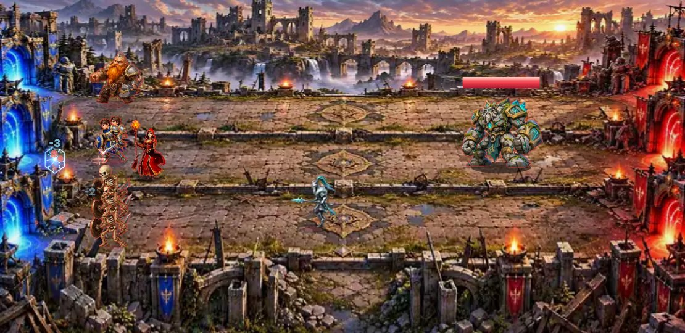

Önce/sonra: aynı boss, KIRMIZI takım, sola yürürken 7 karede bir (yeşil çizgi = zemin). Üst satır v3.60.285, alt satır v3.60.286. Faz şeridi: doğma, yürüme, durma, arkadaki hedefe saldırı, hasar, ölüm (740×360).

### Taş Kolosus (Kristal Kolos)

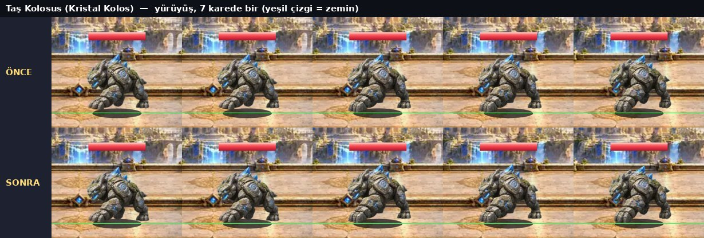

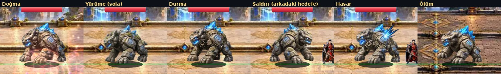

### Kadim Dev

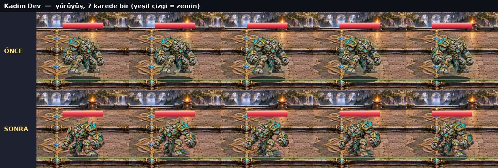

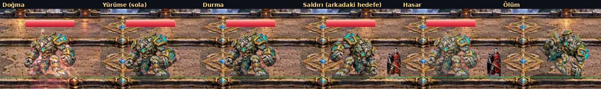

### Ölüm Lordu

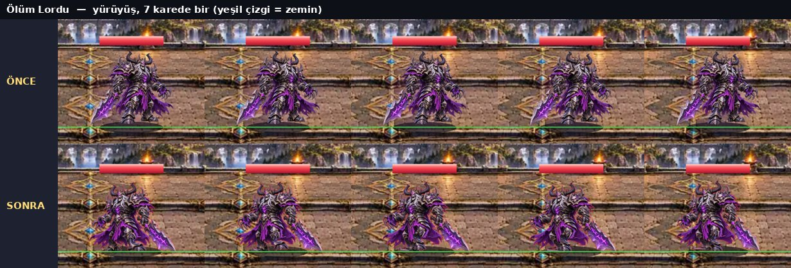

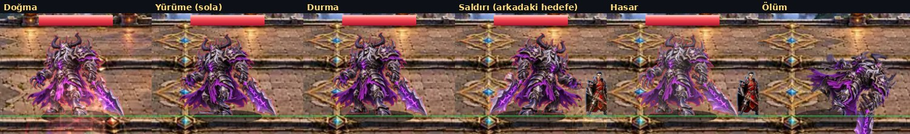

### Orman Koruyucusu

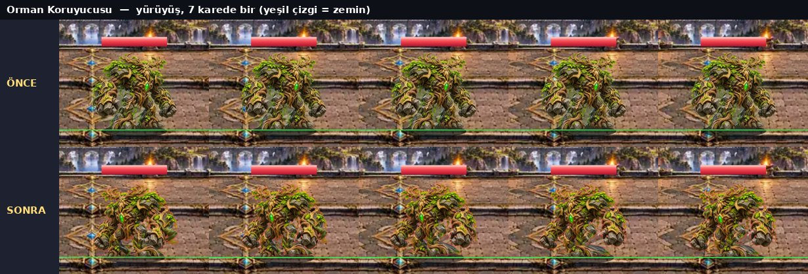

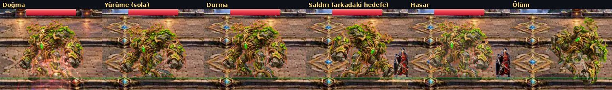

### Cehennem Behemotu

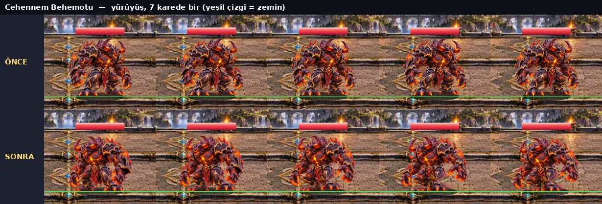

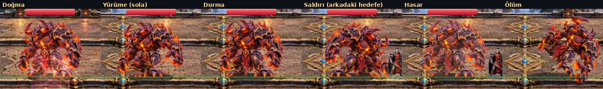

### Gölge Avcısı

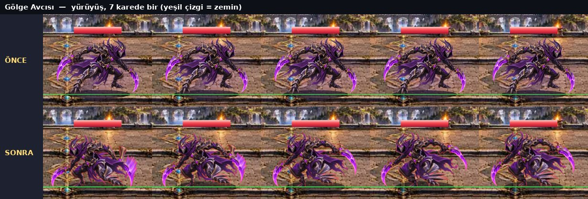

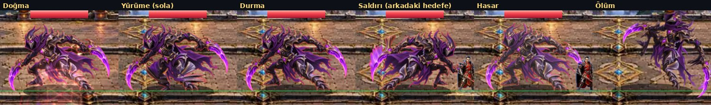

### Lav Ejderhası

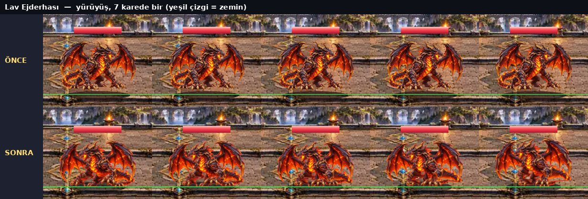

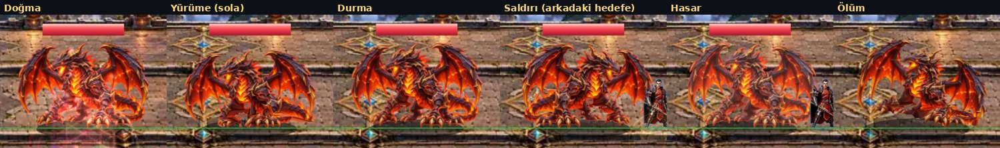

### Fırtına Ejderi

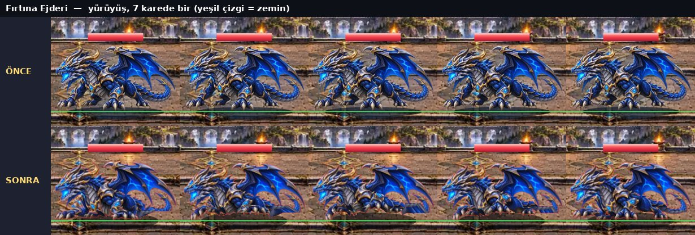

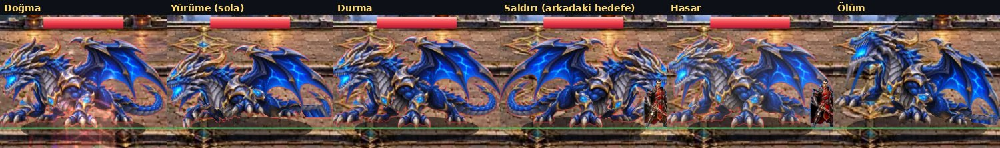

### Zehir Hidrası

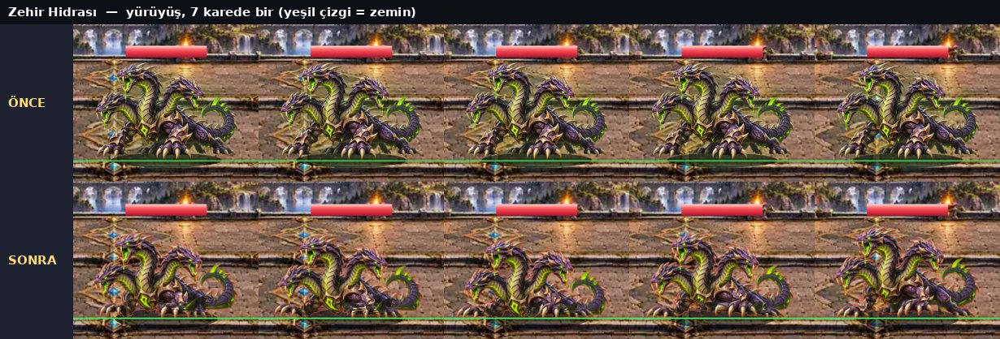

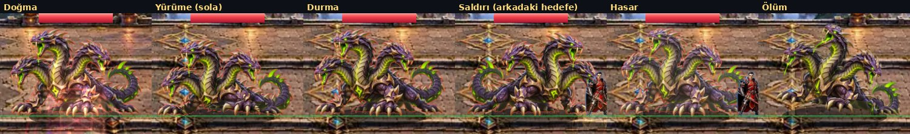

### Örümcek Kraliçe

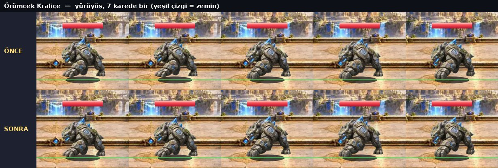

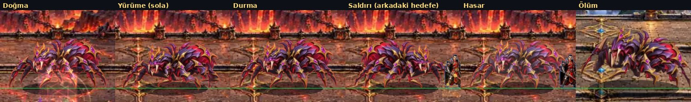

### Küllerin Hükümdarı

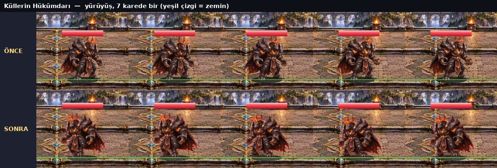

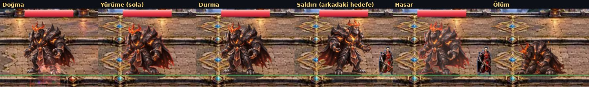

### Uçurum Ejderi

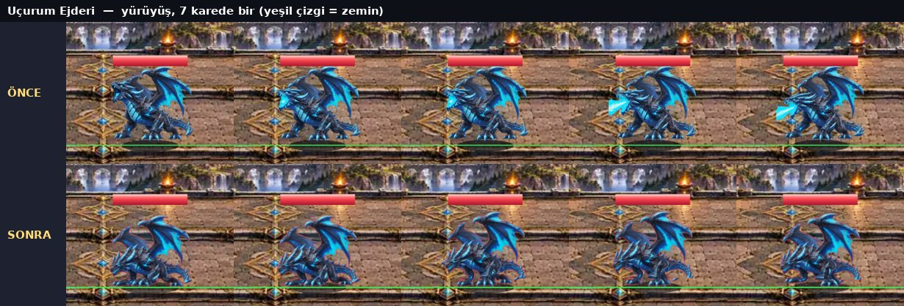

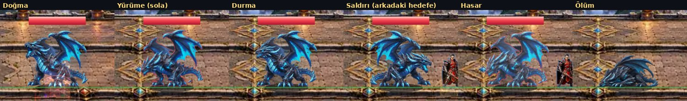

### Boşluk İmparatoru

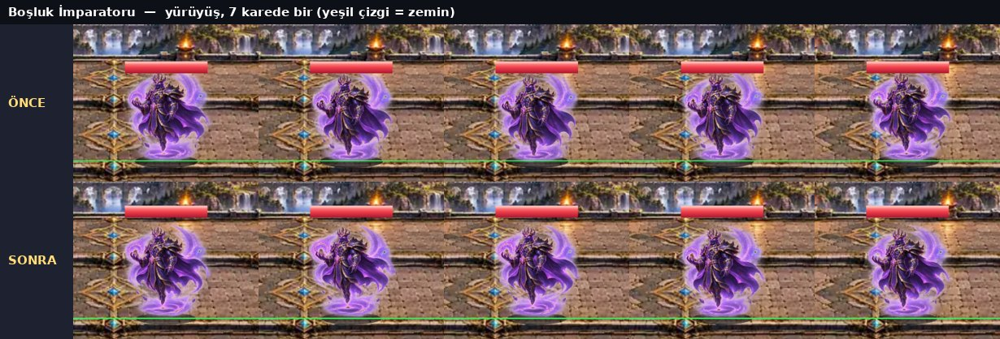

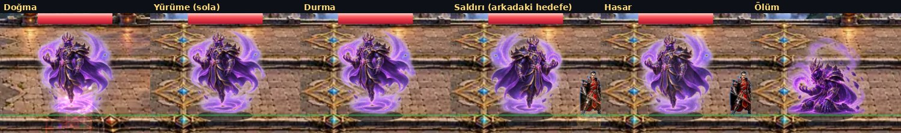

### Ayna Celladı (Yankı İstilası)

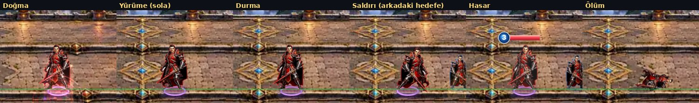

## Test edilemeyenler ve sınırlar (dürüst not)

- **Gerçek Android WebView:** TEST EDİLEMEDİ. Bu bulut ortamında cihaz veya emülatör yok. Çözünürlükler masaüstü Chromium'da telefon görünüm alanıyla (DPR 2) test edildi.
- **Doğal karşılaşmalar:** Yalnız Doruk Kulesi 5. katta Kadim Dev'in oyunun kendi akışıyla doğuşu gerçek savaşta doğrulandı (`gorseller/gercek_savas_kule5_kadim_dev.png`). Diğer bosslar, oyunun gerçek çizim fonksiyonu (`draw`) ile laboratuvar modunda (savaş döngüsü duraklatılmış, boss doğrudan doğurulmuş) test edildi; Karanlık Geçit, Kristal Kolos, Yankı İstilası, Hikâye Seferi ve Gökyüzü karşılaşmaları uçtan uca oynanmadı.
- **WebGL yoksa:** AF321 motorunun mevcut 2B yedek çizimi kemik eğmesi yapmaz (tüm karakterler için geçerli, önceden de böyleydi). Bu durumda bosslar zeminde ve doğru yönde durur ama bacak hareketi görünmez. Android WebView'da WebGL normalde vardır.
- **Boşluk İmparatoru** bacaksız, süzülen bir büyücü olarak çizilmiş; adım atan bacak animasyonu yok (çizim böyle). Rün dairesi zemine oturur.
- **Kanatlı ejderler** (Lav, Fırtına, Uçurum): kanat kemikleri arka ayak düz tabanı için kullanıldı; kanatlar artık gövdeyle birlikte hareket eder (ayrı çırpma yok).
- Mavi takımda boss oyunda doğal olarak çıkmaz (tüm bosslar rakip tarafında doğuyor); mavi takım testleri istenen yön kuralı için yapıldı ve çizim yolu buna göre iki takımı da destekler.

## Kodda değişenler (yalnız çizim)

- **AF321 iskelet motoru** (kapsamı yalnız boss rig bayraklarıyla sınırlı; minyon rig'lerinde etkisizdir): `R.cad` ağır adım temposu; `R.quad` ön bacak IK'sı (`armIK`), dört ayaklı faz dizilimi, saldırıda pati kaldırma, ölümde çökme; `R.flat` düz taban kemiği (dört ayaklıda düz pati); `R.snapY` yere yakın sahipsiz pikselleri en yakın ayağa bağlama; `R.noTerr` diz altı kuralını kapatma ve IK erişim payı; `K.footSole` uzuv başına taban hizası; ön bacakların pelvis indirme hesabına katılması.
- **Yeni boss modülü** (`afp286*`): görselden çalışma anında 256 px gövde atlası kurar, rig'i kaydeder, ekran boyunu ve yatay konumu önceki sürümle birebir korur; yön kuralı, zemin sınırı, temas çözümü, ölüm çizimi.
- `af36DrawBossArtwork` (sabit-resim yolu): önce iskelet; yedek çizimde ölçülen taban, zıplama yok, mavi takımda ayna.
- `af263DrawBossAnim` / `af263DrawBossDeaths` (Karanlık Geçit): ortak modül + kare kare taban hizası, doğal bakış yönü.
- `afpColossusDrawAtlasV36074`, `afpDrawColossusBossV36074`, `afpDrawColossusFallenV36074` (Kristal Kolos): kare tabanı, yürüme fazı, öncelik, ölüm sırası, yön.
- `afpSpiderDrawCore` kraliçe dalı: ortak modül.
- `drawHero`: bosslar iki takımda da boss çizim yoluna girer; Kolos her modda kendi atlası; Ayna Celladı hedefe döner ve ayrı iskelet kopyası kullanır.
- Ölüm kaydı (`fallenUnits.push`): `bossRig` alanı; Kolos takım fark etmeksizin kendi ölüm atlası.
- Test kancası `window.__AFPBossGaitQA` (yalnız çağrıldığında çalışır).

## Performans

Zemin sınırı + temas çözümünün CPU maliyeti boss başına ≈0.005–0.02 ms/kare (`__AFPBossGaitQA.lab.perfBoss`). Gövde ağı mevcut AF321 WebGL yoluyla çizilir (minyonlarla aynı yol). Bu test ortamında WebGL yazılımsaldır (SwiftShader); kare süreleri gerçek cihazı temsil etmez ve cihazda ölçülmedi.

## Değişmeyenler

Boss canı, saldırı gücü, hızı, yetenekleri; 59 minyonun yetenekleri ve çizimi; kart, enerji, 12 kartlık deste; dokuz modun kuralları; 430 portal canı; çevrim içi eşleşme; ödül ve kayıt sistemleri; `arenaForgeProProfileV19` kayıt anahtarı. Yama yalnız çizim kodunu değiştirir (hiçbir oyun alanı yazılmaz; yalnız `_afp286*` görsel durum alanları). Ayna Celladı için minyonlarla paylaşılan iskelet değiştirilmedi, ayrı kopya kullanıldı. Tek görsel süre değişikliği: iskeletli bossların ölüm görüntüsü 0.95 → 1.6 sn (yalnız görsel kayıt ömrü).

## Sayfa hataları

- 740x360: 0 hata 
- 667x375: 0 hata 
- 800x360: 0 hata 
