# Android yatay ekran ölçüleri — 740×360 · 667×375 · 800×360

**Ne yapıldı:** v3.60.262 Chromium'da mobil öykünmeyle açıldı:
- `isMobile`, dokunmatik, yatay, cihaz piksel oranı 2;
- her ölçüde **temiz profille**.

Her ölçüde aynı yol izlendi; her adımın ekran görüntüsü alındı:
1. giriş
2. ilk minyon (yeni oyuncu)
3. ana üs
4. mod galerisi
5. Hikâye Seferi
6. Kule savaşı
7. sonuç ekranı

**Ne yapılmadı:**
- **Gerçek telefonda veya Android WebView'da** test yapılmadı. Bu ortamda cihaz yok.
- Çentik / kamera deliği ve sistem çubukları (`safe-area-inset`) öykünmede **sıfır**, gerçek cihazda farklı olabilir.
- Dokunma gecikmesi, GPU belleği ve gerçek FPS **ölçülmedi**.

## Ölçümler

| | 740×360 | 667×375 | 800×360 |
|---|---|---|---|
| Sayfa taşması (scrollWidth × scrollHeight) | 740×360 ✅ | 667×375 ✅ | 800×360 ✅ |
| Açılışta JS / sayfa hatası | 0 | 0 | 0 |
| Açılışta dış ağ isteği | 0 (yalnız HTML) | 0 | 0 |
| Giriş ekranı ilk boyama | ~0,3 sn; giriş ekranı 1 sn'de tam | aynı | aynı |
| Eski arena görüntüsü sızması / siyah kenar | Görülmedi (0,5–15 sn arası 6 kare) | Görülmedi | Görülmedi |
| Hikâye Seferi aşama paneli ilk satır | ✅ v262'de görünür (v261'de kesik) | ✅ | ✅ |
| Savaş döngüsü hata sayacı | 0 | 0 | 0 |

Ek ölçümler (headless Chromium, GPU yok, cihaz ölçümü **değildir**):
- HTML 46,9 MB, `DOMContentLoaded` 2,6 sn, JS yığını ~111 MB.
- Savaşta ~36 FPS. Oyun kendi düşük güç kipini (`LOW_POWER_DEVICE`) açıp kare atlıyor; tuval 1110×540.

## Ekran görüntüleri

Hepsi `ekran_goruntuleri/android/` içinde, `ÖLÇÜ_NN_ad.webp` adıyla.

| Adım | 740×360 | 667×375 | 800×360 |
|---|---|---|---|
| Giriş | 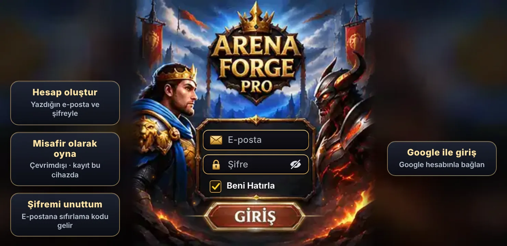 | 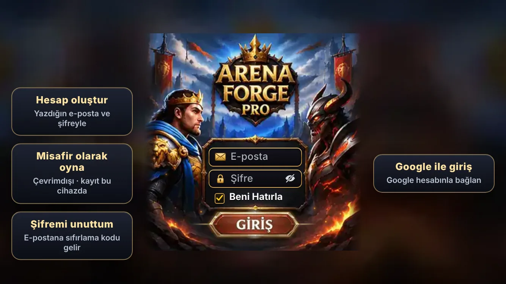 | 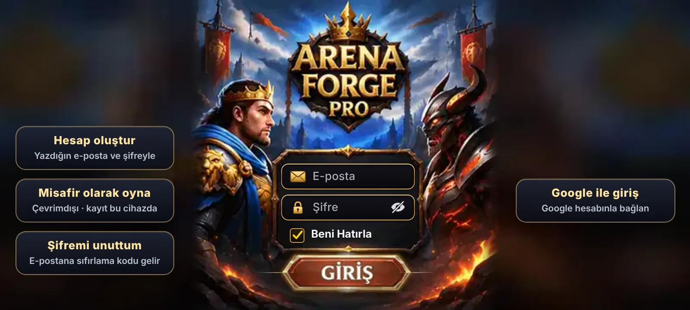 |
| Ana üs | 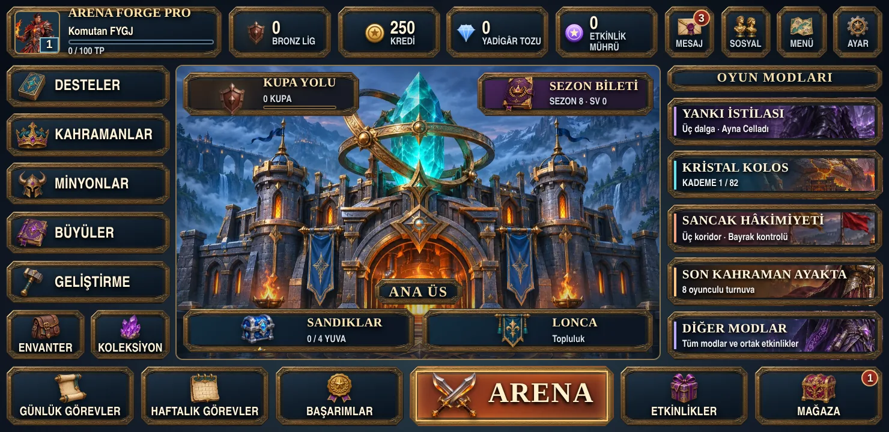 | 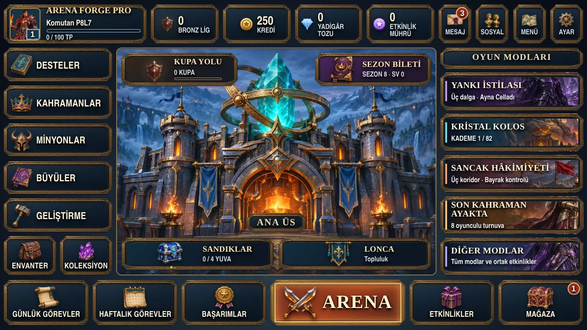 | 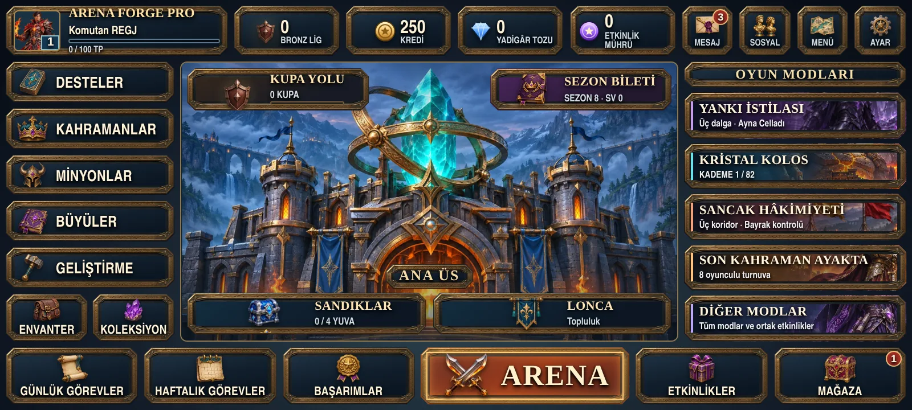 |
| Mod galerisi | 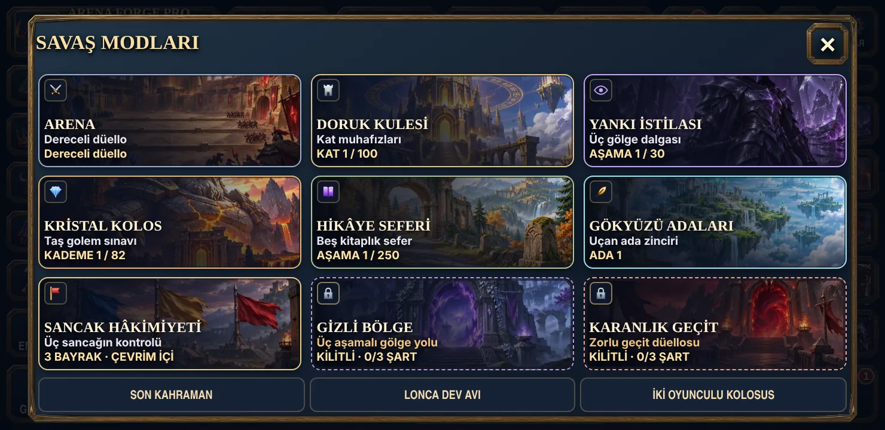 | 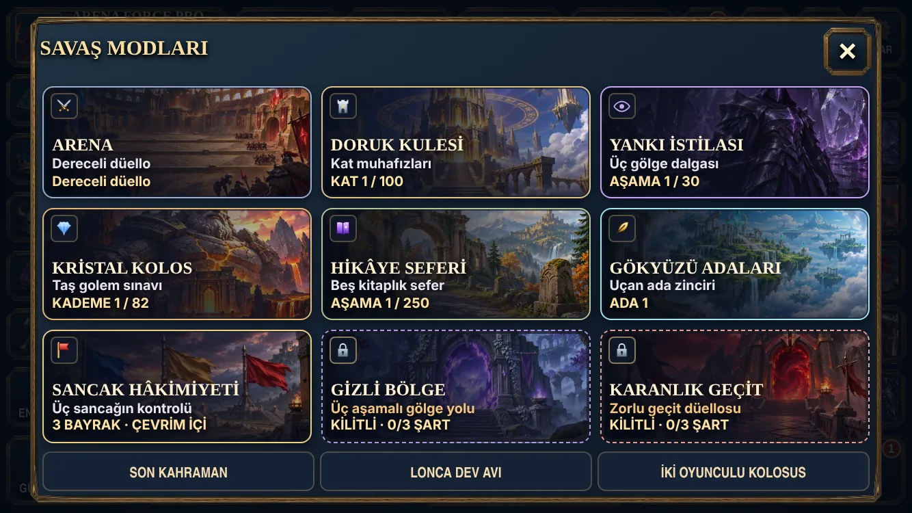 | 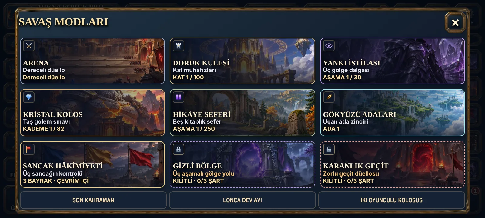 |
| Hikâye Seferi | 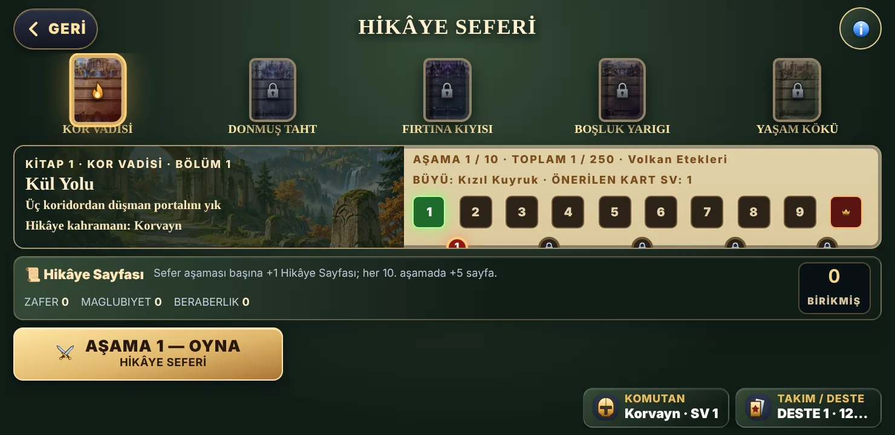 | 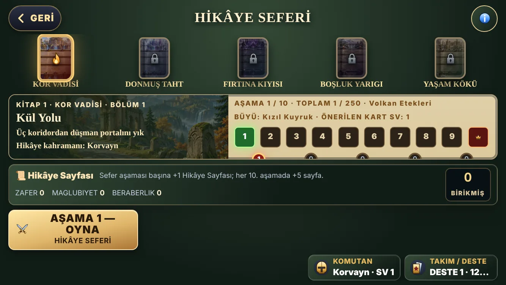 | 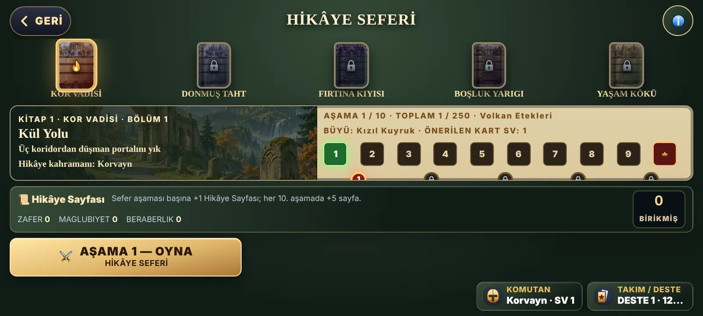 |
| Savaş | 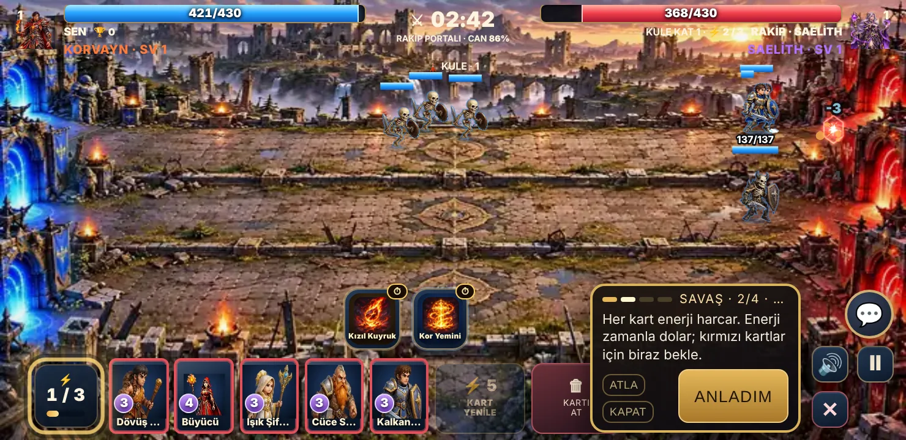 | 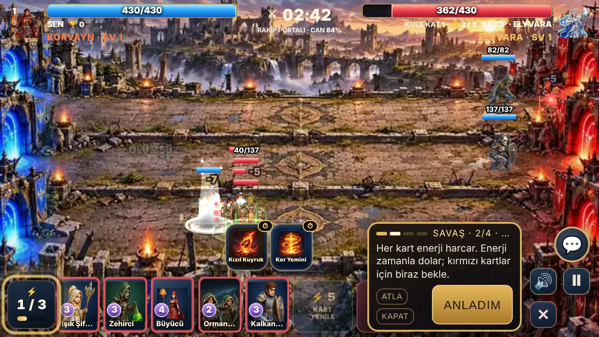 | 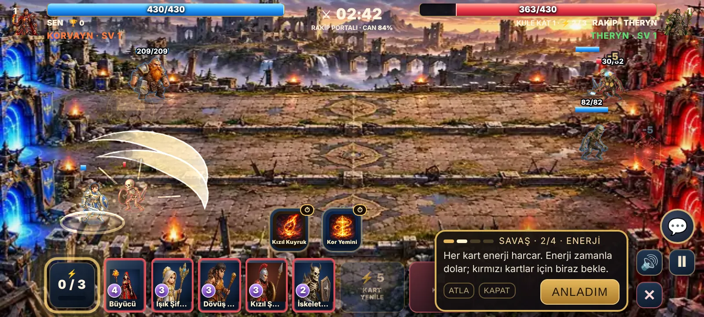 |
| Sonuç | 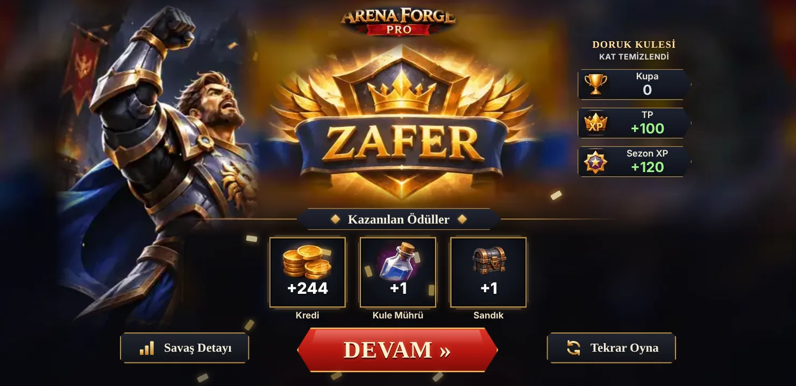 | 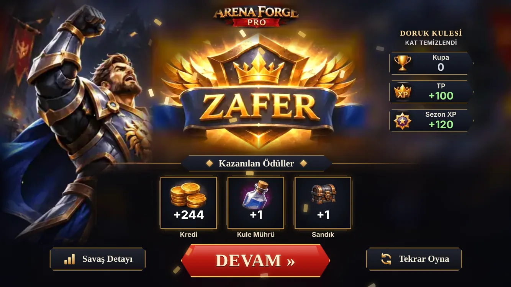 | 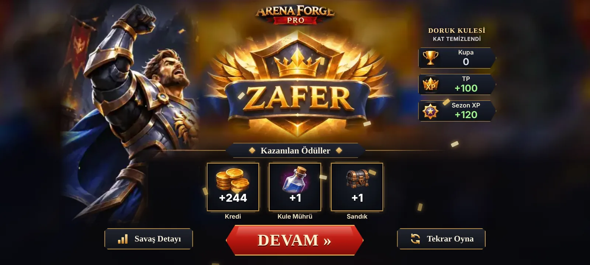 |

## Gözlenen arayüz durumu

- **Ana üs:** Üst kaynak çubuğu, sol menü, orta kale, sağ mod listesi ve alt düğmeler üç ölçüde de sığıyor. Yazı taşması ya da zorunlu kaydırma yok.
- **Mod galerisi:** 9 mod ve 3 ek kart üç ölçüde tek ekranda.
- **Savaş HUD:** Portal çubukları, süre, 3 koridor, el (5 kart), enerji, büyü düğmeleri ve duraklat/çık düğmeleri görünür ve dokunulabilir.
- **Koridor kapatma:** Sancak skor kutusu dışında koridoru kapatan kalıcı öğe görülmedi; o da v262'de düzeldi.
- **Rehber balonu:** Yeni oyuncuda rehber balonu savaşta sağ altta kartın bir kısmını örtüyor. KAPAT ile kapanıyor.
- **Mod lobileri:** Sancak kuralları ve Karanlık Geçit şart listesi panelden uzun ama **kaydırılabilir**. İçerik kaybolmuyor, yalnız kaydırma çubuğu gizli.
